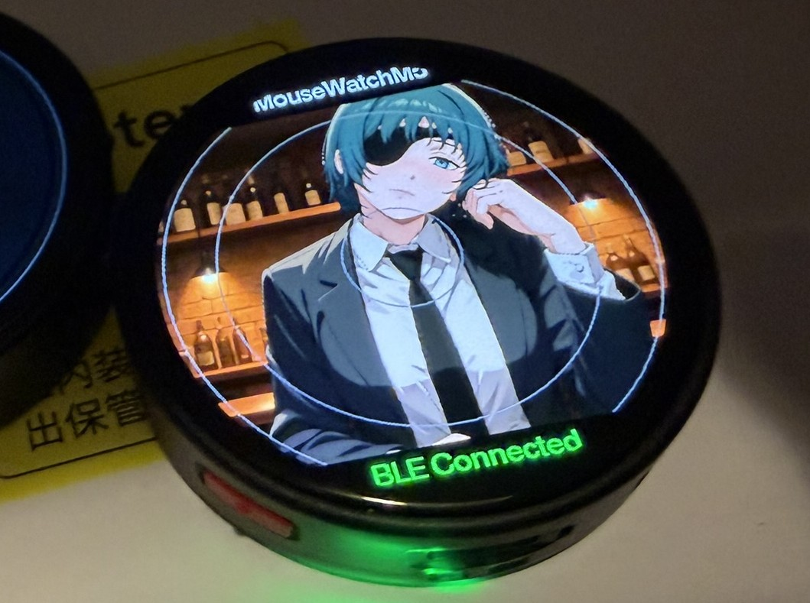
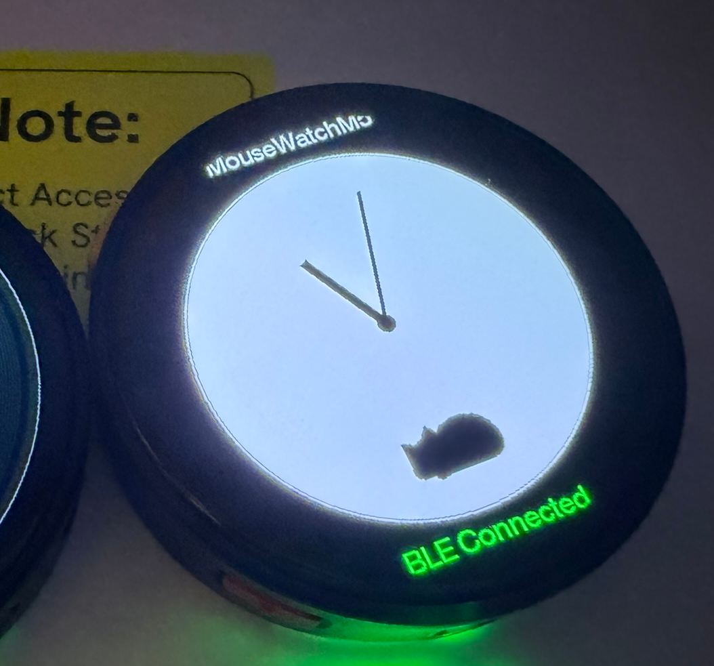

# MouseWatchM5

  
  

M5Stack **StopWatchをBluetoothマウスにする**アプリです。画面をなぞってカーソル移動、外周をなぞってスクロール。好きな画像を背景にして使えます。

**好きな画像を「Mouse Face」にできます。猫が好きなら、猫が住む時計「Cat Clock」にもできます。**

> **M5Burner シェアコード：`ghY29E2KIHDJOvuY`**

## 使い方

1. M5Burnerでシェアコードを検索し、StopWatchへ書き込みます。
2. 起動後、**本体の左右いずれかのボタン**でマウスを開始します。設定するときは、**起動画面の円の中心をタップ**します。
3. iPadやPCのBluetooth設定で **MouseWatchM5** を選び、接続します。
4. 画面の中央をなぞるとカーソル移動、軽くタップするとクリック。外周のリングをなぞるとスクロールできます。本体の左右ボタンもクリックに使えます。

### iPadで使う場合 / iPad Bluetooth mouse

iPadでは `設定 → Bluetooth` を開き、「その他のデバイス」から **MouseWatchM5** を選んで接続してください。接続後はポインタやスクロールを利用できます（**iPadOS 13.4以降**）。

- [Apple公式：iPadにBluetoothマウスを接続する方法](https://support.apple.com/ja-jp/108938)
- [Apple公式：iPadでBluetoothマウス／トラックパッドを使う・設定する](https://support.apple.com/ja-jp/105004)
- [BLEマウスの仕組みと実装例：ESP32-BLE-Mouse（GitHub）](https://github.com/T-vK/ESP32-BLE-Mouse)
- [iPad BLEマウスをWebで調べる（Google検索）](https://www.google.com/search?q=ipad+ble+pad+mouse)

## 設定

起動画面の中央をタップすると、次の3項目が表示されます。

| メニュー | 内容 |
| --- | --- |
| **Watch Face** | Single Image / Cat Clock / USB Drive |
| **Mouse Setting** | 利き手、カーソル速度、リングスクロール、スクロール方向 |
| **Exit** | 設定を終えてマウスを開始 |

### 好きな画像を背景にする

1. **Watch Face → USB Drive** を選択します。本体がUSBドライブモードへ切り替わります。
2. USBでPCに接続し、表示したいJPEG/PNGをドライブへコピーします。
3. PCで**安全に取り外し**てから、本体のボタンで通常モードへ戻ります。
4. 起動画面中央 → **Watch Face → Single Image [SET]** を開き、画像を選んで **USE THIS IMAGE** をタップします。
5. 画像は画面に合わせて縮小・中央クロップされ、加工結果がFlashに保存されます。

画像を登録していなくても、通常のBLEマウスとして使用できます。

### Cat Clock

**Watch Face → Cat Clock** で、猫が動き回るアナログ時計をマウスの背景にできます。時計表示中もカーソル移動やクリックができます。

---

## English

**MouseWatchM5** turns the M5Stack StopWatch into a Bluetooth mouse. Swipe the center to move the pointer, tap to click, and trace the outer ring to scroll.

**Make any picture your Mouse Face—or choose Cat Clock, an animated clock with a resident cat.**

**M5Burner share code: `ghY29E2KIHDJOvuY`**

### Getting started

1. Find the share code in M5Burner and install it on your StopWatch.
2. Press either hardware button on the startup screen to start mouse mode. Tap the center of the startup screen for **Settings**.
3. Pair **MouseWatchM5** in your iPad or computer's Bluetooth settings.
4. Swipe the center to move the cursor, tap to click, or trace the outer ring to scroll. The hardware buttons also provide mouse clicks.

### iPad pairing and reference links

On iPad, open **Settings → Bluetooth**, then select **MouseWatchM5** under Other Devices. Bluetooth mouse support requires **iPadOS 13.4 or later**.

- [Apple: Connect a Bluetooth mouse to iPad (Japanese)](https://support.apple.com/ja-jp/108938)
- [Apple: Use and customize an iPad mouse (Japanese)](https://support.apple.com/ja-jp/105004)
- [ESP32 BLE Mouse library / implementation reference](https://github.com/T-vK/ESP32-BLE-Mouse)
- [More information: iPad BLE mouse search](https://www.google.com/search?q=ipad+ble+pad+mouse)

### Settings and photos

- **Watch Face:** Single Image, Cat Clock, USB Drive.
- **Mouse Setting:** handedness, pointer speed, scroll ring, and scroll direction.
- **Exit:** start mouse mode.

To use your own photo, select **Watch Face → USB Drive**, connect to a computer, copy a JPEG or PNG, and safely eject. Return to normal mode with a hardware button, then select **Single Image [SET] → USE THIS IMAGE**. The selected photo is resized and center-cropped for the screen, with the processed result cached in flash.

**Cat Clock** shows an animated cat in an analog clock while the mouse remains usable. Photos are optional.

---

Made for **M5Stack StopWatch**.
